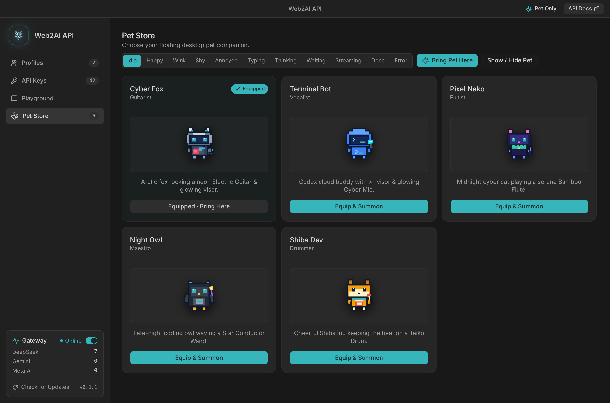
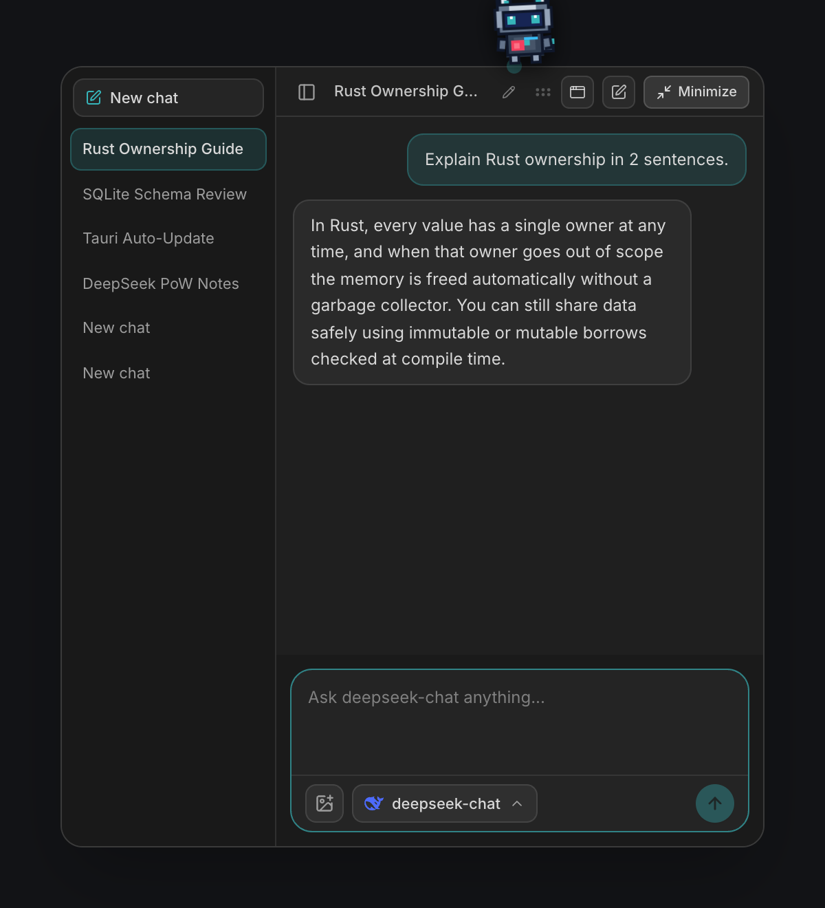

# Web2AI API

> **Unofficial & Experimental**
>
> This project interfaces with **undocumented web APIs** from DeepSeek, Google Gemini, and Meta AI. It is not affiliated with or endorsed by any provider. Credentials (tokens/cookies) may expire, and rate limits or upstream changes can occur without notice. Intended for personal use, research, and local prototyping.

**Web2AI API** is a desktop application and local **OpenAI-compatible API gateway** (`http://127.0.0.1:8088`) supporting **DeepSeek**, **Gemini**, and **Meta AI**, with multi-profile Round-Robin load balancing, sticky session continuity, streaming, and Vision support.

## Supported Providers

| Logo | Provider | Status | Auth | Features |
| :---: | --- | :---: | --- | --- |
|  | **DeepSeek** | ✅ Completed | `token` | Streaming, Reasoning (`deepseek-reasoner`), Sticky Sessions |
|  | **Google Gemini** | 🚧 In Progress | `cookie` | Streaming, Vision (`image_url`), Sticky Sessions |
|  | **Meta AI** | 🚧 In Progress | `cookie` | Streaming, Sticky Sessions |

---

## Quick Start

```bash
# Install dependencies (first time)
cd desktop && bun install && cd ..

# Launch the desktop app
bun run dev
```

---

## Desktop Gateway & API Playground

| Provider Profiles | API Playground |
|---|---|
|  |  |

## Pet Store & Floating Desktop Pet

| Pet Store (5 Pixel-Art Companions) | Floating Pet Chat |
|---|---|
|  |  |

---

## Floating Desktop Pet

Web2AI API Desktop includes an always-on-top **Floating Desktop Pet** that lets you chat with your local models right from your desktop.

- **5 Pixel-Art Companions (Pet Store)**: **Cyber Fox** (Electric Guitar), **Terminal Bot** (Cyber Mic), **Pixel Neko** (Bamboo Flute), **Night Owl** (Star Wand), and **Shiba Dev** (Taiko Drum).
- **Expressive Reactions**: Reacts live while you type, wait for replies, or stream responses — and responds with playful moods when you click on the pet.
- **Quick Chat**: Click the toolbar or status bar below the pet to expand quick chat, switch between recent threads, or start a new conversation.
- **Easy Controls**: Use **Bring Pet Here** in **Pet Store** or the system tray menu (**Show/Hide Pet**) to find or toggle your pet anytime.

---

## API Reference

Base URL: `http://127.0.0.1:8088`

### System

| Method | Endpoint | Description |
|---|---|---|
| `GET` | `/health` | Gateway status and active profile counts per provider |
| `GET` | `/docs` | Interactive API documentation |

### OpenAI-Compatible Chat & Models

Base URL for OpenAI SDKs & clients: `http://127.0.0.1:8088/v1`

| Method | Endpoint | Description |
|---|---|---|
| `GET` | `/v1/models` | List all available models in `provider:model` format |
| `POST` | `/v1/chat/completions` | Chat completion using `model: "provider:model"` (`stream: true` for SSE, `image_url` for Vision) |

### Profiles & API Keys

| Method | Endpoint | Description |
|---|---|---|
| `GET` | `/v1/profiles` | List profiles (optional `?type=deepseek\|gemini\|metaai`) |
| `POST` | `/v1/profiles` | Create profile (`token` for DeepSeek, `cookie` for Gemini/Meta AI) |
| `GET` / `PUT` / `DELETE` | `/v1/profiles/{id}` | Read, update, or delete a profile |
| `GET` / `POST` | `/v1/keys` | List or create API keys |
| `POST` | `/v1/keys/revoke` | Revoke an API key |
| `DELETE` | `/v1/keys/{key}` | Delete an API key |

---

## Examples

### Chat Completion

```bash
curl -s http://127.0.0.1:8088/v1/chat/completions \
  -H "Authorization: Bearer YOUR_API_KEY" \
  -H "Content-Type: application/json" \
  -d '{
    "model": "deepseek:deepseek-chat",
    "messages": [{"role": "user", "content": "Hello!"}],
    "stream": false
  }'
```

### Multi-Turn Session (`X-Session-Id`)

```bash
curl -s http://127.0.0.1:8088/v1/chat/completions \
  -H "Authorization: Bearer YOUR_API_KEY" \
  -H "X-Session-Id: my-session-001" \
  -H "Content-Type: application/json" \
  -d '{
    "model": "deepseek:deepseek-chat",
    "messages": [{"role": "user", "content": "Remember this code: 42"}]
  }'
```

### Multimodal Vision (`image_url`)

```bash
curl -s http://127.0.0.1:8088/v1/chat/completions \
  -H "Authorization: Bearer YOUR_API_KEY" \
  -H "Content-Type: application/json" \
  -d '{
    "model": "deepseek:deepseek-chat",
    "messages": [
      {
        "role": "user",
        "content": [
          { "type": "text", "text": "Describe this image." },
          {
            "type": "image_url",
            "image_url": { "url": "https://raw.githubusercontent.com/PokeAPI/sprites/master/sprites/pokemon/25.png" }
          }
        ]
      }
    ]
  }'
```

---

## Documentation

- [Desktop App Guide](desktop/README.md)
- [Architecture Overview](docs/ARCHITECTURE.md)
- [Authentication & Session Management](docs/auth.md)

---

## Installation Notes (macOS & Windows)

Prebuilt binaries from GitHub Releases are not yet signed with paid Apple Developer or Windows Code Signing certificates, so your OS may show an "unidentified developer" warning on first launch:

- **macOS (Gatekeeper)**: After dragging `Web2AI.app` to `Applications`, run once in Terminal:
  ```bash
  xattr -cr /Applications/Web2AI.app
  ```
  *(Or go to **System Settings → Privacy & Security → Open Anyway**.)*
- **Windows (SmartScreen)**: Click **More info → Run anyway** on the Windows Defender SmartScreen prompt.
