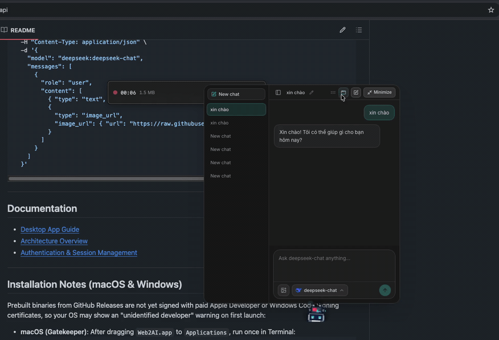
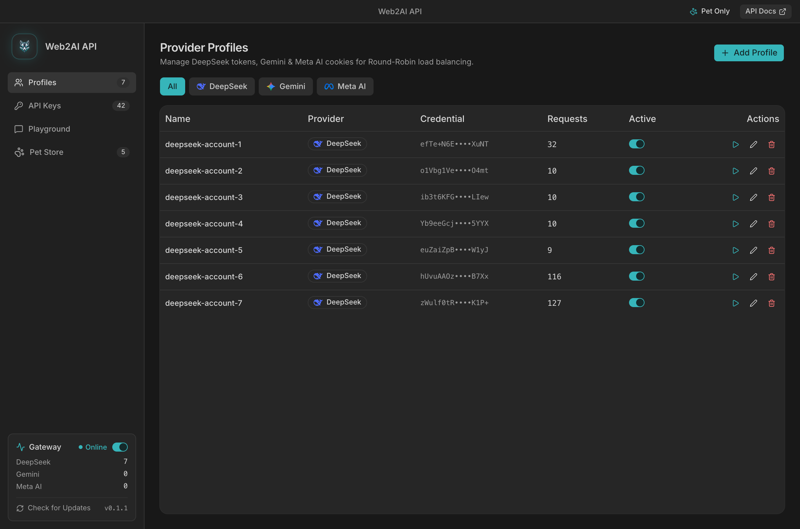
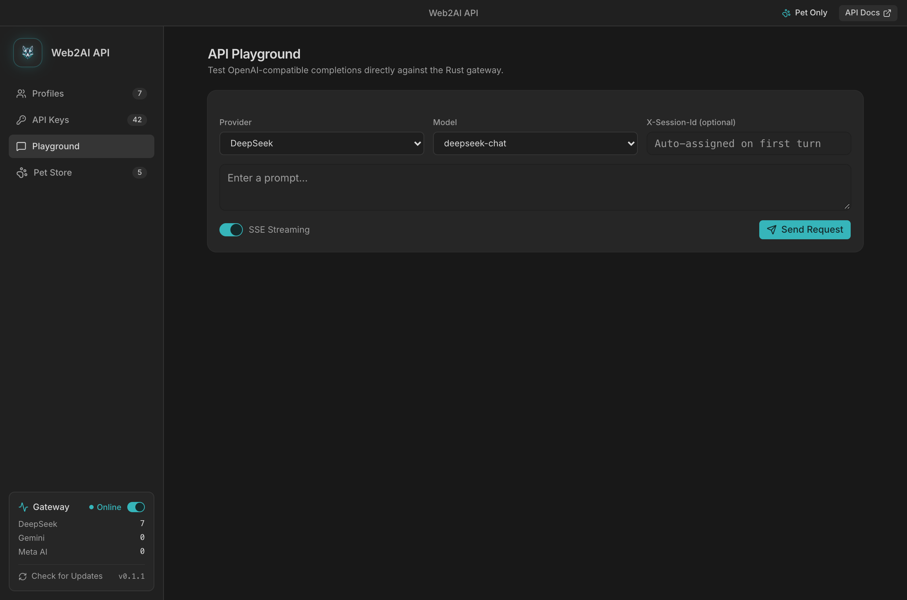

# Web2AI API

> **Unofficial & Experimental**
>
> This project interfaces with **undocumented web APIs** from DeepSeek, Google Gemini, and Meta AI. It is not affiliated with or endorsed by any provider. Credentials (tokens/cookies) may expire, and rate limits or upstream changes can occur without notice. Intended for personal use, research, and local prototyping.

**Web2AI API** is a desktop application and local **OpenAI-compatible API gateway** (`http://127.0.0.1:8088`) currently focused on **DeepSeek** (`deepseek:deepseek-chat`, `deepseek:deepseek-reasoner`), featuring multi-profile Round-Robin load balancing, virtual session continuity, SSE streaming, Vision, and OpenAI-compatible **Structured JSON Outputs (`response_format`)**.

## Supported Providers

| Logo | Provider | Status | Auth | Features | Docs |
| :---: | --- | :---: | --- | --- | :---: |
|  | [**DeepSeek**](docs/providers/deepseek.md) | ✅ Active | `token` | Streaming, Reasoning (`deepseek-reasoner`), Structured JSON (`response_format`), Sticky Sessions | [Guide](docs/providers/deepseek.md) |
|  | **Google Gemini** | 🚧 In Progress | `cookie` | Planned (hidden from `/v1/models` until complete) | Coming soon |
|  | **Meta AI** | 🚧 In Progress | `cookie` | Planned (hidden from `/v1/models` until complete) | Coming soon |

---

## Quick Start

```bash
# Install dependencies (first time)
cd desktop && bun install && cd ..

# Launch the desktop app
bun run dev
```

---

## See It in Action



## Desktop Gateway & API Playground

| Provider Profiles | API Playground |
|---|---|
|  |  |

## Pet Store & Floating Desktop Pet

| Pet Store (5 Pixel-Art Companions) | Floating Pet Chat |
|---|---|
|  |  |

---

## Floating Desktop Pet

Web2AI API Desktop includes an always-on-top **Floating Desktop Pet** that lets you chat with your local models right from your desktop.

- **5 Pixel-Art Companions (Pet Store)**: **Cyber Fox** (Electric Guitar), **Terminal Bot** (Cyber Mic), **Pixel Neko** (Bamboo Flute), **Night Owl** (Star Wand), and **Shiba Dev** (Taiko Drum).
- **Expressive Reactions**: Reacts live while you type, wait for replies, or stream responses — and responds with playful moods when you click on the pet.
- **Quick Chat**: Click the toolbar or status bar below the pet to expand quick chat, switch between recent threads, or start a new conversation.
- **Easy Controls**: Use **Bring Pet Here** in **Pet Store** or the system tray menu (**Show/Hide Pet**) to find or toggle your pet anytime.

---

## API Reference

Base URL: `http://127.0.0.1:8088`

### System

| Method | Endpoint | Description |
|---|---|---|
| `GET` | `/health` | Gateway status and active profile counts per provider |
| `GET` | `/docs` | Interactive API documentation |

### OpenAI-Compatible Chat & Models

Base URL for OpenAI SDKs & clients: `http://127.0.0.1:8088/v1`

> **Authentication (Production vs Development)**
> - **Release builds**: API key authentication is **required** (`Authorization: Bearer <key>` or `X-Api-Key`). Create and copy a key from the **API Keys** tab in the desktop app.
> - **Development (`tauri dev` / debug builds)**: API key checks are skipped automatically (you can pass any dummy string like `"sk-dev"` in OpenAI SDKs). Override with `DISABLE_AUTH=true` or `REQUIRE_API_KEY=true`.

| Method | Endpoint | Description |
|---|---|---|
| `GET` | `/v1/models` | List active models in `provider:model` format (`deepseek:deepseek-chat`, `deepseek:deepseek-reasoner`) |
| `POST` | `/v1/chat/completions` | Chat completion supporting `stream`, `response_format` (`text`, `json_object`, `json_schema`), `image_url`, and `X-Session-Id` |

### Profiles & API Keys

| Method | Endpoint | Description |
|---|---|---|
| `GET` | `/v1/profiles` | List profiles (optional `?type=deepseek`) |
| `POST` | `/v1/profiles` | Create profile (`token` for DeepSeek) |
| `GET` / `PUT` / `DELETE` | `/v1/profiles/{id}` | Read, update, or delete a profile |
| `GET` / `POST` | `/v1/keys` | List or create API keys |
| `POST` | `/v1/keys/revoke` | Revoke an API key |
| `DELETE` | `/v1/keys/{key}` | Delete an API key |

---

## Examples

### Chat Completion

```bash
curl -s http://127.0.0.1:8088/v1/chat/completions \
  -H "Authorization: Bearer YOUR_API_KEY" \
  -H "Content-Type: application/json" \
  -d '{
    "model": "deepseek:deepseek-chat",
    "messages": [{"role": "user", "content": "Hello!"}],
    "stream": false
  }'
```

### Structured JSON Output (`response_format`)

Web2AI supports OpenAI's `response_format` parameter (`text`, `json_object`, and `json_schema`). Upstream responses are automatically extracted from markdown fences, repaired with `jsonrepair-rs`, validated against your JSON Schema (with a 1-shot self-correction retry if needed), and returned cleanly for both `stream: false` and `stream: true` without polluting virtual session history.

#### Node.js / TypeScript (Official `openai` SDK)

```ts
import OpenAI from "openai";

const client = new OpenAI({
  baseURL: "http://127.0.0.1:8088/v1",
  apiKey: process.env.WEB2AI_API_KEY ?? "YOUR_API_KEY",
});

const res = await client.chat.completions.create({
  model: "deepseek:deepseek-chat",
  messages: [{ role: "user", content: "Create an invoice for 2 books at 15 USD each." }],
  response_format: {
    type: "json_schema",
    json_schema: {
      name: "invoice",
      strict: true,
      schema: {
        type: "object",
        properties: {
          currency: { type: "string", enum: ["USD", "VND"] },
          total_amount: { type: "number", minimum: 0 },
        },
        required: ["currency", "total_amount"],
        additionalProperties: false,
      },
    },
  },
});

console.log(JSON.parse(res.choices[0].message.content ?? "{}"));
```

#### Python (Official `openai` SDK + Pydantic)

```python
from openai import OpenAI
from pydantic import BaseModel

class CityCard(BaseModel):
    name: str
    country: str

client = OpenAI(base_url="http://127.0.0.1:8088/v1", api_key="YOUR_API_KEY")
schema = {**CityCard.model_json_schema(), "additionalProperties": False}

res = client.chat.completions.create(
    model="deepseek:deepseek-chat",
    messages=[{"role": "user", "content": "Describe Hanoi."}],
    response_format={
        "type": "json_schema",
        "json_schema": {"name": "city_card", "strict": True, "schema": schema},
    },
)
print(CityCard.model_validate_json(res.choices[0].message.content))
```

### Multi-Turn Session (`X-Session-Id`)

```bash
curl -s http://127.0.0.1:8088/v1/chat/completions \
  -H "Authorization: Bearer YOUR_API_KEY" \
  -H "X-Session-Id: my-session-001" \
  -H "Content-Type: application/json" \
  -d '{
    "model": "deepseek:deepseek-chat",
    "messages": [{"role": "user", "content": "Remember this code: 42"}]
  }'
```

### Multimodal Vision (`image_url`)

```bash
curl -s http://127.0.0.1:8088/v1/chat/completions \
  -H "Authorization: Bearer YOUR_API_KEY" \
  -H "Content-Type: application/json" \
  -d '{
    "model": "deepseek:deepseek-chat",
    "messages": [
      {
        "role": "user",
        "content": [
          { "type": "text", "text": "Describe this image." },
          {
            "type": "image_url",
            "image_url": { "url": "https://raw.githubusercontent.com/PokeAPI/sprites/master/sprites/pokemon/25.png" }
          }
        ]
      }
    ]
  }'
```

---

## Testing

Run Rust unit & HTTP contract tests, frontend unit tests, and official Node + Python OpenAI SDK E2E suites:

```bash
# Rust unit & mock HTTP contract tests
cd desktop/src-tauri && cargo test

# Official Node.js & Python OpenAI SDK E2E tests (see tests/README.md)
./tests/run_all.sh
```

---

## Documentation

- [Desktop App Guide](desktop/README.md)
- [Architecture Overview](docs/ARCHITECTURE.md)
- [Authentication & Session Management](docs/auth.md)

---

## Installation Notes (macOS & Windows)

Prebuilt binaries from GitHub Releases are not yet signed with paid Apple Developer or Windows Code Signing certificates, so your OS may show an "unidentified developer" warning on first launch:

- **macOS (Gatekeeper)**: After dragging `Web2AI.app` to `Applications`, run once in Terminal:
  ```bash
  xattr -cr /Applications/Web2AI.app
  ```
  *(Or go to **System Settings → Privacy & Security → Open Anyway**.)*
- **Windows (SmartScreen)**: Click **More info → Run anyway** on the Windows Defender SmartScreen prompt.
