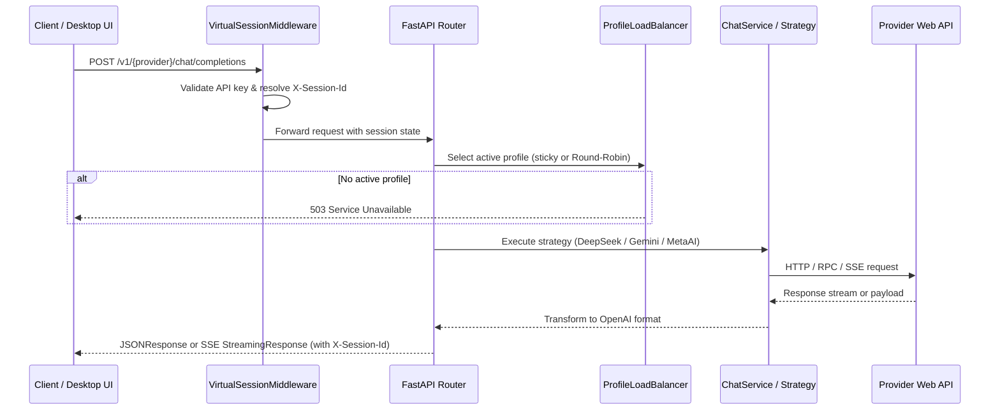

# Architecture

## Overview

This project is a **unified OpenAI-compatible API gateway** with dynamic multi-profile load balancing, virtual session management, a Web Dashboard, and a **Tauri v2 Desktop Application**, proxying requests to **DeepSeek**, **Gemini**, and **MetaAI**:

| Provider | Python SDK / Client | Async/Sync | Auth Method |
|---|---|---|---|
| DeepSeek | Vendored (`deepseek-api/`) | Sync → ThreadPoolExecutor | Profile Token |
| Gemini | Vendored (`Gemini-API/`) | Async (`curl_cffi`) | Profile Cookie |
| MetaAI | Vendored (`metaai-api/`) | Sync → ThreadPoolExecutor | Profile Cookie |

All providers expose OpenAI-compatible endpoints (`/v1/{provider}/models`, `/v1/{provider}/chat/completions`), alongside profile management (`/v1/profiles`) and API key management (`/v1/keys`).

---

## Project Structure

```
web2ai-api/
├── core/
│   ├── server.py              # FastAPI app, lifespan, middleware & router registration
│   ├── db.py                  # SQLite initialization & connection helper (unofficial_api.db)
│   ├── profile.py             # Profile CRUD & request count tracking
│   ├── load_balancer.py       # Multi-profile Round-Robin load balancer & sticky affinity
│   ├── schemas.py             # Shared Pydantic models
│   ├── utils.py               # Shared helpers
│   ├── routers/
│   │   ├── deepseek/          # DeepSeek routes (models, chat/completions)
│   │   ├── gemini/            # Gemini routes + client connection pool (pool.py)
│   │   ├── metaai/            # MetaAI routes (models, chat/completions)
│   │   ├── profiles/          # Profile management CRUD routes
│   │   └── keys/              # API key generation/listing/revocation routes
│   ├── services/              # ChatService + provider strategy implementations
│   └── session/               # VirtualSessionMiddleware, session store, history, API key auth
├── desktop/                   # Tauri v2 Desktop App (React + Vite + Rust)
│   ├── src/                   # Desktop React UI (communicates with local gateway)
│   └── src-tauri/             # Native Rust layer (tray, backend manager, Diesel DB, partial providers)
├── web/                       # Standalone Web Management Dashboard (React + Vite)
├── deepseek-api/              # Vendored DeepSeek SDK
├── Gemini-API/                # Vendored Gemini SDK
├── metaai-api/                # Vendored MetaAI SDK
├── data/                      # SQLite database (unofficial_api.db) & machine_id
├── docs/                      # Project documentation
├── Dockerfile
├── docker-compose.yml
├── pyproject.toml
├── README.md
└── run.sh
```

---

## Desktop Application (`desktop/`)

The desktop app wraps the gateway into a native macOS/Windows/Linux application using **Tauri v2**:

- **Frontend (`desktop/src/`)**: Built with React 19, Vite, and Tailwind CSS v4. It connects over HTTP to `http://127.0.0.1:8088` (`desktop/src/lib/api.ts`) for `/health`, `/v1/profiles`, `/v1/keys`, and `/v1/{provider}/chat/completions`.
- **Native Rust Layer (`desktop/src-tauri/src/`)**:
  - **Backend Process Manager (`lib.rs`)**: On startup, checks whether `127.0.0.1:8088` is reachable. If not, locates the repository root (via `UNOFFICIAL_API_DIR`, working directory, or compile-time manifest path) and spawns `uvicorn core.server:app --host 127.0.0.1 --port 8088` using `.venv/bin/uvicorn` or `uv run uvicorn`. Stops the managed child process cleanly on exit.
  - **System Tray (`lib.rs`)**: Provides **Open Unofficial API**, **Open API Docs**, **Restart Backend**, and **Quit**.
  - **In-Progress Rust Port**: `src-tauri` also includes native Diesel SQLite bindings (`db/mod.rs`), OpenAI types (`openai.rs`), a `wreq` Chrome-emulated HTTP client (`http_client.rs`), and a partial DeepSeek implementation with `wasmi` PoW solving (`providers/deepseek/mod.rs`). Gemini and MetaAI are currently stubs, and an embedded Rust HTTP server + load balancer + session middleware are not yet implemented, so the desktop app still relies on `core/server.py` for runtime API serving.

See [`desktop/README.md`](../desktop/README.md) for desktop setup, scripts, and migration details.

---

## Backend Lifecycle (`core/server.py`)

### Startup & Shutdown (`lifespan`)

1. Loads `.env` via `python-dotenv` (`override=False`).
2. Initializes the SQLite schema in `unofficial_api.db` via `core.db.init_db()`.
3. Registers `VirtualSessionMiddleware` and `CORSMiddleware`.
4. Mounts provider routers (`/v1/deepseek`, `/v1/gemini`, `/v1/metaai`), `/v1/keys`, and `/v1/profiles`.
5. If `web/dist` exists, serves the static Web UI at `/` and `/ui`; otherwise redirects `/` to `/docs`.
6. On shutdown, closes pooled Gemini clients (`await gemini_pool.close_all()`).

### Per-Request Flow



---

## Persistence (`core/db.py` & `unofficial_api.db`)

All runtime state is stored in SQLite (`data/unofficial_api.db` by default, configurable via `UNOFFICIAL_API_DATA_DIR`) in WAL mode:

- `profiles` — Provider credentials (`token` or `cookie`), `is_active`, `total_requests`, and hourly `request_counts`
- `api_keys` — Generated API keys, names, `is_active`, `created_at`, `last_used`
- `sessions` — Virtual session payloads (sticky `profile_id`, provider conversation IDs/metadata, timestamps)
- `assistant_cache` — Prefix hashes of assistant messages mapped to `session_id` for stateless continuation
- `system_settings` — Key-value settings (such as `machine_id`)

---

## Streaming

| Provider | Type | Implementation |
|---|---|---|
| Gemini | Real SSE | `async for chunk in response: yield chunk` |
| DeepSeek | Real SSE | Streams upstream SSE events and translates to OpenAI delta chunks |
| MetaAI | Real SSE | Streams upstream chunks and translates to OpenAI delta chunks |

All providers normalize to the same SSE format:

```
data: {"choices": [{"delta": {"content": "..."}}]}

data: [DONE]
```
